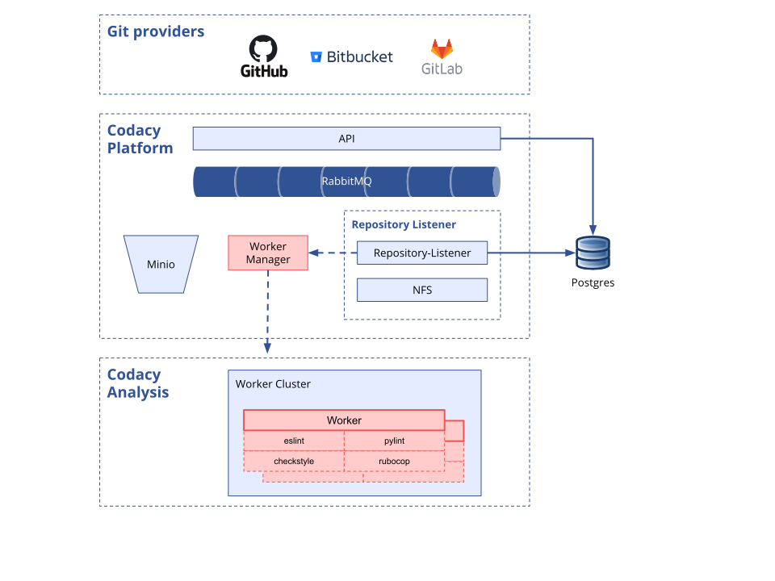

# System requirements

Before installing Codacy Self-hosted you must ensure that you have the following infrastructure correctly provisioned and configured:

-   [Git provider](#git-provider)
-   [Kubernetes or MicroK8s cluster](#kubernetes-or-microk8s-cluster-setup)
-   [PostgreSQL server](#postgresql-server-setup)

The next sections describe in detail how to set up these prerequisites.

## Git provider

To use Codacy Self-hosted, you must use one or more of our [supported Git providers](../faq/general/which-platforms-and-technologies-does-codacy-support.md#supported-version-control-systems-and-git-providers). In particular, if you're using a self-hosted Git provider, make sure that your version is supported by Codacy.

## Kubernetes or MicroK8s cluster setup

The cluster running Codacy must satisfy the following requirements:

-   The infrastructure hosting the cluster must be provisioned with the hardware and networking requirements described below
-   The orchestration platform managing the cluster must be one of:
    -   [Kubernetes](https://kubernetes.io/) **version 1.22.\*** to **1.27.\*** (1.26 recommended)
    -   [MicroK8s](https://microk8s.io/) **version 1.19.\***
-   The [NGINX Ingress controller](https://github.com/kubernetes/ingress-nginx) must be installed and correctly set up in the cluster

### Cluster networking requirements

The cluster must be configured to accept and establish connections on the following ports:

|          | Service      | Protocol/Port | Notes                                                              |
| -------- | ------------ | ------------- | ------------------------------------------------------------------ |
| Inbound  | SSH          | TCP/22        | **MicroK8s only**, to access the infrastructure remotely.          |
| Inbound  | HTTP         | TCP/80        | Allow access to the Codacy website and API endpoints               |
| Inbound  | HTTPS        | TCP/443       | Allow access to the Codacy website and API endpoints               |
| Outbound | PostgreSQL   | TCP/5432      | Connection to the PostgreSQL DBMS                                  |
| Outbound | SMTP         | TCP/25        | Connection to your SMTP server                                     |
| Outbound | SMTPS        | TCP/465       | Connection to your SMTP server over TLS/SSL                        |
| Outbound | Docker Hub   | \*            | Connection to Docker Hub to download the required container images |
| Outbound | Git provider | \*            | Connection to the ports required by your remote Git provider       |

### Cluster hardware requirements

The high-level architecture described in the next section is important in understanding how Codacy uses and allocates hardware resources. Below we also provide guidance on [resource provisioning for typical scenarios](#standard-cluster-provisioning).

For a custom hardware resource recommendation, please contact us at <mailto:support@codacy.com>.

#### Codacy architecture

You can look at Codacy as two groups of components:

-   The **"Platform"** contains the UI and other components important to treat and show results
-   The **"Analysis"** is the swarm of workers that run **between one and four** linters simultaneously, depending on factors such as the number of files or the programming languages used in your projects



Since all components are running on a cluster, you can increase the number of pod replicas in every deployment to give you more resilience and throughput, at a cost of increased resource usage.

The following is a simplified overview of how to calculate resource allocation for the group of components "Platform" and "Analysis":

| Group of components                                           | vCPU                        | Memory                          |
| ------------------------------------------------------------- | --------------------------- | ------------------------------- |
| Platform<br/>(1 pod replica per component)                    | 4                           | 8 GB                            |
| Analysis<br/>(1 Analysis Worker pod with **up to** 4 linters) | 5<br/>(per Analysis Worker) | 10 GB<br/>(per Analysis Worker) |

#### Standard cluster provisioning

As described in the section above, Codacy's architecture allows scaling the "Analysis" group of components, meaning that the resources needed for Codacy **depend mainly on the rate of commits** done by your team that Codacy will be analyzing.

The resources recommended on the following table are based on our experience and are also the defaults in the [`values-production.yaml`](./values-files/values-production.yaml) file. You might need to adapt these defaults taking into account your use case. In particular, you should set the value of `global.workerManager.workers.config.dedicatedMax` to the maximum number of concurrent analysis depending on the available resources and number of replicas per component.

!!! note
    For MicroK8s clusters we added an extra 1.5 vCPU and 1.5 GB memory to the "Platform" to account for the MicroK8s platform itself running on the same machine.

| Installation type                            | Pod replicas per component | Max. concurrent analysis | Platform resources          | Analysis resources        | **~ Total resources**         |
| -------------------------------------------- | -------------------------- | ------------------------ | --------------------------- | ------------------------- | ----------------------------- |
| Kubernetes<br/>Small Installation            | 1                          | 2                        | 4 vCPUs<br/>8 GB RAM        | 10 vCPUs<br/>20 GB RAM    | **16 vCPUs<br/>32 GB RAM**    |
| Kubernetes<br/>Medium Installation (default) | 2                          | 4                        | 8 vCPUs<br/>16 GB RAM       | 20 vCPUs<br/>40 GB RAM    | **32 vCPUs<br/>64 GB RAM**    |
| Kubernetes<br/>Big Installation              | 2+                         | 10+                      | 8+ vCPUs<br/>16+ GB RAM     | 50+ vCPUs<br/>100+ GB RAM | **60+ vCPUs<br/>110+ GB RAM** |
| MicroK8s<br/>Minimum                         | 1                          | 2                        | 5.5 vCPUs<br/>9.5 GB RAM    | 10 vCPUs<br/>20 GB RAM    | **16 vCPUs<br/>32 GB RAM**    |
| MicroK8s<br/>Recommended (default)           | 1+                         | 2                        | 9.5+ vCPUs<br/>17.5+ GB RAM | 10 vCPUs<br/>20 GB RAM    | **21+ vCPUs<br/>40+ GB RAM**  |

The storage requirements recommended on the following table **depend mainly on the number of repositories** that Codacy will be analyzing and should be used as a guideline to determine your installation requirements.

| Component  | Bundled in the chart?        | **Minimum recommended** |
| ---------- | ---------------------------- | ----------------------- |
| NFS        | Yes                          | **200 GB**              |
| RabbitMQ   | Yes                          | **8 GB**                |
| MinIO      | Yes                          | **20 GB**               |
| PostgreSQL | No (external DB recommended) | **500 GB+**             |

!!! note
    Please note that due to the way Codacy works, a small number of pods will run in privileged mode with the `CAP_SYS_ADMIN` capability. This is required to allow the Worker pods to serve NFS shares to be mounted by the pods running the static code analysis tools.

## PostgreSQL server setup

Codacy requires a database server to persist data that must satisfy the following requirements:

-   The infrastructure hosting the database server must be provisioned with the hardware requirements described below
-   The DBMS server must be [PostgreSQL](https://www.postgresql.org/) **version 11.20** or **version 12.\*** (12.* recommended)
-   The PostgreSQL server must be configured to accept connections from the cluster
-   The Codacy databases and a dedicated user must be created using the instructions below

!!! important
    Google, the developer of Kubernetes, [doesn't recommend running database servers on your cluster](https://cloud.google.com/blog/products/databases/to-run-or-not-to-run-a-database-on-kubernetes-what-to-consider). As such, consider using a managed solution like Amazon RDS or Google Cloud SQL, or running the PostgreSQL server on a dedicated virtual machine.

    We recommend that you use a managed solution to reduce maintenance and configuration costs of the PostgreSQL server. The main cloud providers all have this service that you can use, for example:

    -   [Amazon RDS for PostgreSQL](https://aws.amazon.com/rds/postgresql/resources/) or [Amazon Aurora PostgreSQL-Compatible Edition](https://aws.amazon.com/rds/aurora/postgresql-features/)
    -   [Azure Database for PostgreSQL](https://docs.microsoft.com/en-us/azure/postgresql/)
    -   [Google Cloud SQL for PostgreSQL](https://cloud.google.com/sql/docs/postgres)
    -   [Digital Ocean Managed Databases](https://www.digitalocean.com/products/managed-databases-postgresql/)


### PostgreSQL hardware requirements

The following are the minimum specifications recommended for provisioning the PostgreSQL server:

| vCPUs | Memory | Storage | Max. concurrent connections |
| ----- | ------ | ------- | --------------------------- |
| 4     | 8 GB   | 500 GB+ | 300                         |

### Preparing PostgreSQL for Codacy

Before installing Codacy you must create a set of databases that will be used by Codacy to persist data. We also recommend that you create a dedicated user for Codacy, with access permissions only to the databases that are specific to Codacy:

1.  Connect to the PostgreSQL server as a database admin user. For example, using the `psql` command line client:

    ```bash
    psql -U postgres -h <PostgreSQL server hostname>
    ```

2.  Create the dedicated user that Codacy will use to connect to PostgreSQL. Make sure that you change the username and password to suit your security needs:

    ```sql
    CREATE USER codacy WITH PASSWORD 'codacy';
    ALTER ROLE codacy WITH CREATEDB;
    ```

    Take note of the username and password you define, as you will require them later to configure the connection from Codacy to the PostgreSQL server.

3.  Make sure that you can connect to the PostgreSQL database using the newly created user. For example, using the `psql` command line client:

    ```bash
    psql -U codacy -d postgres -h <PostgreSQL server hostname>
    ```

4.  Create the databases required by Codacy:

    ```sql
    CREATE DATABASE accounts WITH OWNER=codacy;
    CREATE DATABASE analysis WITH OWNER=codacy;
    CREATE DATABASE results WITH OWNER=codacy;
    CREATE DATABASE metrics WITH OWNER=codacy;
    CREATE DATABASE filestore WITH OWNER=codacy;
    CREATE DATABASE jobs WITH OWNER=codacy;
    CREATE DATABASE listener WITH OWNER=codacy;
    CREATE DATABASE crow WITH OWNER=codacy;
    ```
