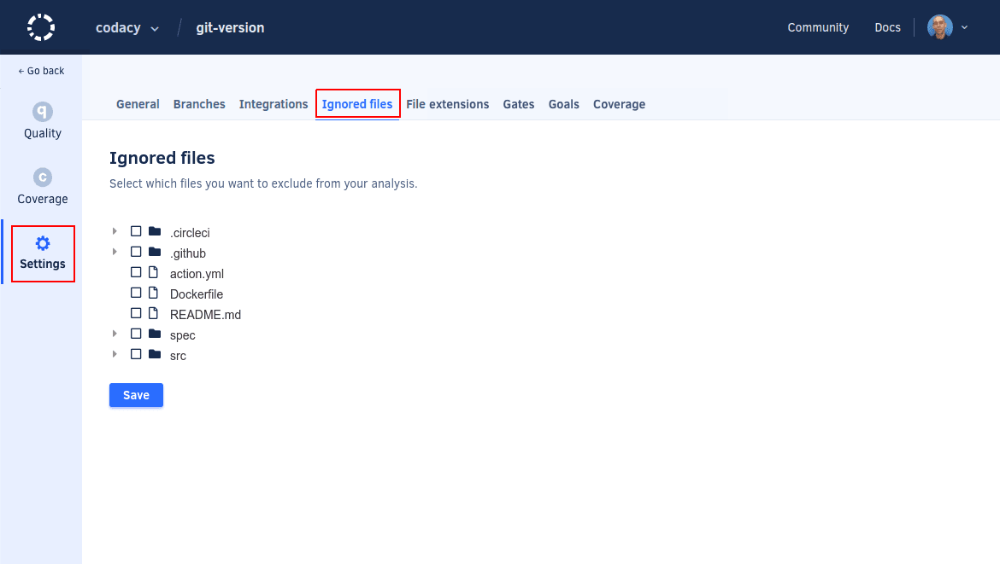

# Ignoring files

On Codacy Self-hosted, you ignore files and folders from the repository **Settings**. Ignore generated code, third-party libraries, and other files that aren't relevant to your project, so that Codacy reports issues only on the code your team maintains.

To ignore files and folders:

1.  Open your repository **Settings**, tab **Ignored files**.

    The list shows the files and folders on your main branch.

1.  Select the files and folders that you want to ignore.

1.  Click **Save**.



You can also ignore files using your own [tool configuration files](../../repositories-configure/configuring-code-patterns.md#using-your-own-tool-configuration-files), although this depends on the option being supported by each tool.

If you need more flexibility in ignoring files, such as ignoring files that match a pattern, use a Codacy configuration file to [define a custom list of file paths to exclude](../../repositories-configure/codacy-configuration-file.md#syntax-for-ignoring-files). If your repository has a Codacy configuration file, the **Ignored files** settings on the Codacy UI don't apply.

!!! note
    

## Default ignored files

By default, Codacy Self-hosted ignores all the files that match the regular expressions below. To override these defaults, use a Codacy configuration file to [define a custom list of file paths to exclude](../../repositories-configure/codacy-configuration-file.md#syntax-for-ignoring-files).

```text
.*[\.-]min\.css
.*[\.-]min\.js
.*node_modules/.*
.*bower_components
.*vendor/.*
.*third[_-]?[Pp]arty
.*docs?/.*
.*samples
.*releases?/.*
.*builds
.*dist/.*
.*external
.*libs/.*
.*d3\.js
.*angular(-resource|)?\.js
.*select2(-resource|)?\.js
.*-ace\.js
.*typeahead\.js
.*jquery-ui\.js
.*reveal\.js
.*three\.js
.*chart\.js
.*jquery\.js
.*underscore\.js
.*lodash\.js
.*bootstrap\.js
.*bootstrap\.css
.*font-awesome\.css
```
