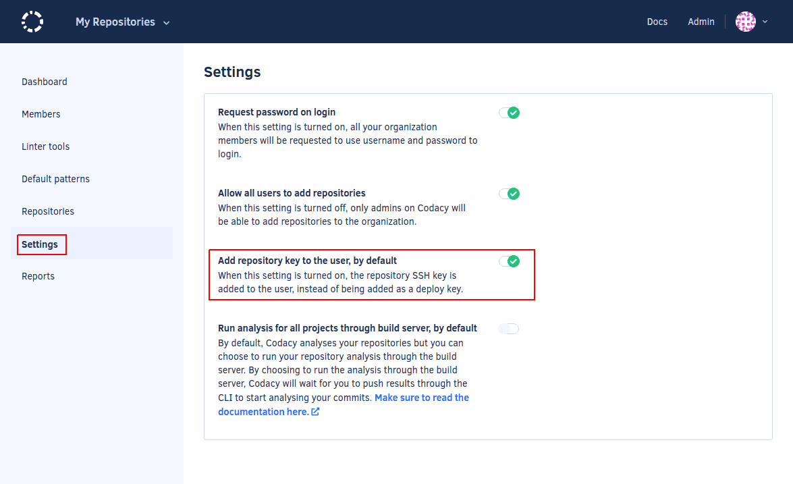
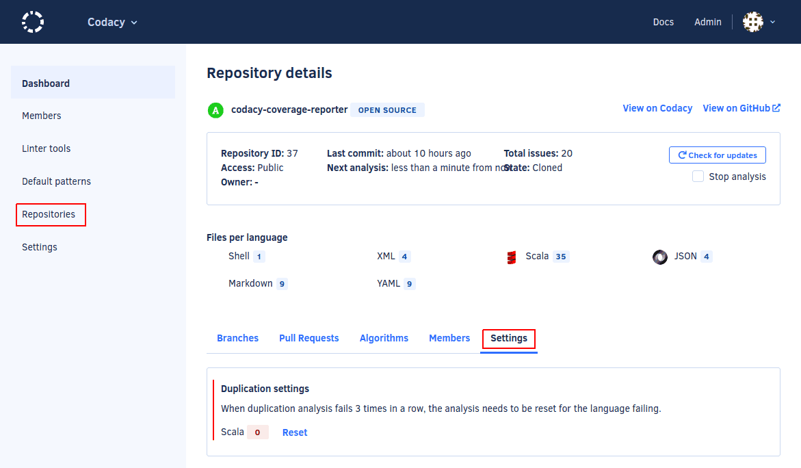

# Using Codacy tools with Codacy Self-hosted

The pages for Codacy Coverage Reporter, client-side tools, the Codacy API, and submodules describe Codacy Cloud. Their steps also work on Codacy Self-hosted, with the changes on this page: your instance URL instead of `app.codacy.com`, and the tool versions for your Codacy Self-hosted version.

Each Codacy Self-hosted version works with these tool versions:

{{ self_hosted_table("analysis_cli", "coverage_reporter") }}

## Codacy Coverage Reporter {: id="coverage-reporter"}

Follow [Adding coverage to your repository](../../coverage-reporter/index.md). Before you run Codacy Coverage Reporter, set your Codacy instance URL and the Codacy Coverage Reporter version for your Codacy Self-hosted version:


```bash
export CODACY_API_BASE_URL=<your Codacy instance URL>
export CODACY_REPORTER_VERSION={coverage_reporter}
```

{{ self_hosted_tabs(command) }}

If you use one of the [alternative ways of running Codacy Coverage Reporter](../../coverage-reporter/alternative-ways-of-running-coverage-reporter.md), such as the Docker image or a binary, use the same version.

## Client-side tools {: id="client-side-tools"}

Follow [Running local analysis](../../repositories-configure/local-analysis/client-side-tools.md) with the [Codacy Analysis CLI](https://github.com/codacy/codacy-analysis-cli) at the version for your Codacy Self-hosted version. Before you run the Codacy Analysis CLI, set your Codacy instance URL:

```bash
export CODACY_API_BASE_URL=<your Codacy instance URL>
```

<!-- TODO: verify whether the newer @codacy/analysis-cli (the "Codacy Analysis CLI" page in Developer tools) works with Codacy Self-hosted v10 to v17. Its code reads CODACY_API_BASE_URL and, for upload, CODACY_RESULTS_API_BASE_URL (codacy/analysis-cli @e539fa9), but it calls API v3 endpoints that may postdate Codacy Self-hosted v10. Until the CLI owners confirm, this page points to codacy/codacy-analysis-cli, the CLI each Codacy Self-hosted release pins. -->

## Codacy API {: id="api"}

Follow [Using the Codacy API](../../codacy-api/using-the-codacy-api.md), using your Codacy instance domain name in the API URLs. The endpoint documentation on your instance matches your Codacy Self-hosted version:

```text
https://<your Codacy instance domain name>/api/api-docs

https://<your Codacy instance domain name>/api/v3
```

The [request rate limit](../../codacy-api/using-the-codacy-api.md#request-rate-limit) doesn't apply to Codacy Self-hosted.

## Submodules {: id="submodules"}

Follow [Using submodules](../../repositories-configure/using-submodules.md), with two differences:

-   After Codacy enables submodules for you, [update your license](../maintenance/license.md).
-   To add the SSH key to your Git provider account automatically for every new repository, enable **Add project key to the user, by default** on the **Administration** console, page **Settings**. This isn't supported on Bitbucket Cloud, where the setting must be turned off.

    

## Duplication metrics {: id="duplication"}

If an analysis finishes but [the code duplication metric isn't calculated](../../faq/troubleshooting/why-arent-duplication-metrics-being-calculated.md), reset the duplication analysis: open the **Admin panel**, **Repositories**, select the repository, tab **Settings**, and reset the code duplication analysis in **Duplication settings**. Then, reanalyze the last commit in the repository.



## Seat usage {: id="seat-usage"}

To see how your organization uses its licensed seats, run [<span class="skip-vale">codacy-usage-report</span>](https://github.com/codacy/codacy-usage-report). It reports the activity of the users on your Codacy Self-hosted instance.

If you decide to cancel, contact <mailto:support@codacy.com>.

## See also

-   [What's available on Codacy Self-hosted](../whats-available-on-codacy-self-hosted.md)
-   [Upgrading Codacy](../maintenance/upgrade.md)
