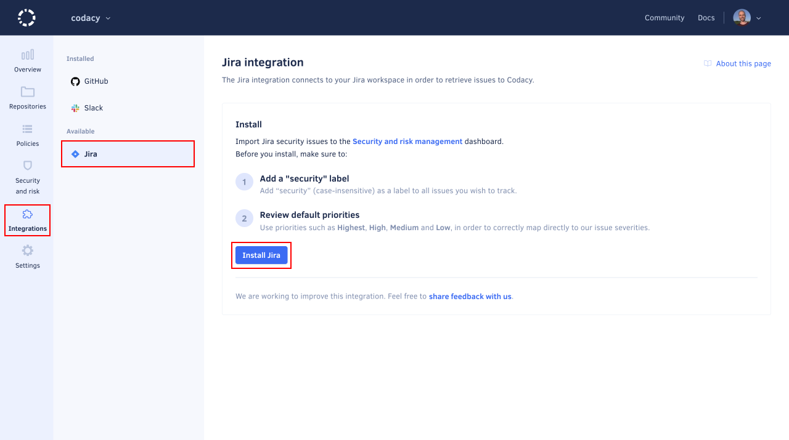
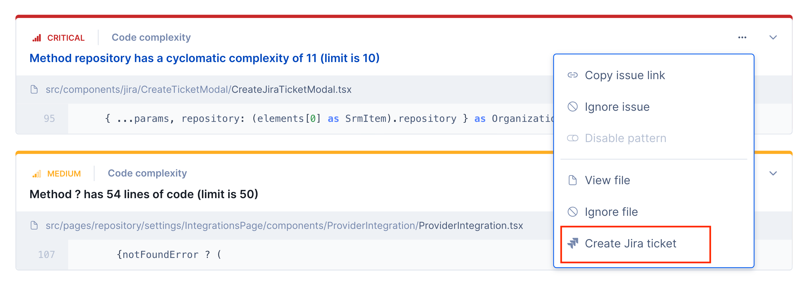
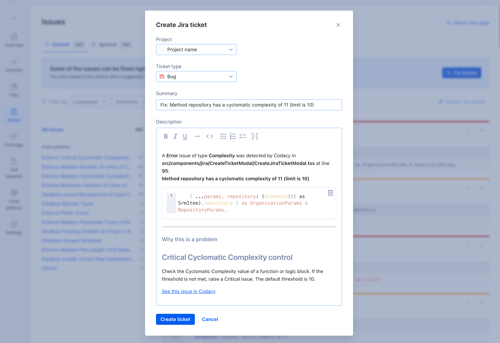
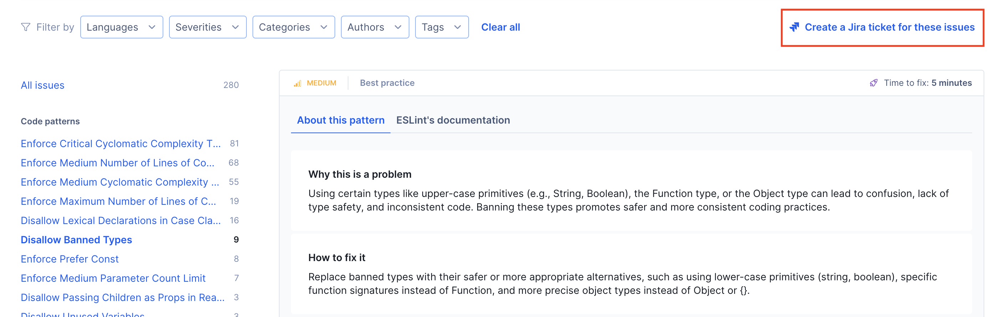
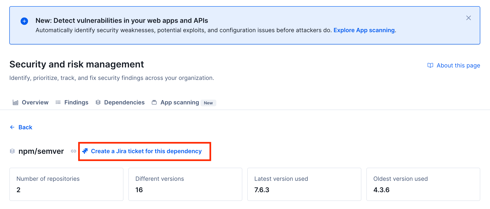
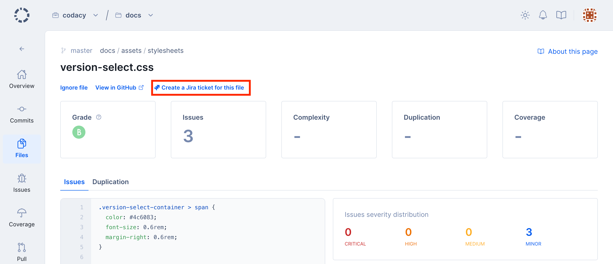

# Organization Jira integration

!!! info "This integration is only available for Jira Cloud"

Integrate Jira with Codacy to be able to create Jira tickets directly from Codacy findings, and import your Jira issues for [Security and risk management](../../security/index.md) to manage them all in one place as security items.

## Installing the Jira integration

To install the Jira integration:

1.  On Jira, add the label **security** (case-insensitive) to the issues you wish to import and confirm that they use [the right Jira priorities to correctly map to item severities](../../security/findings.md#item-severities-and-deadlines).

    !!! tip
        Add the **security** label as a default to all new Jira issues that track security-related work in your organization.

1.  Open your organization **Integrations**, page **Jira**, and click **Install Jira** to proceed to Atlassian's website.

    !!! note
        Use a Jira account with admin permissions when installing this integration. This lets Codacy access all issues, since the integration inherits the permissions of the account that installs it.

    

1.  On Atlassian's website, authorize Codacy. Once successful, you're redirected back to Codacy.

After installing, Codacy imports all open Jira issues labeled **security** and created up to 90 days before the integration and then retrieves updates from Jira once a day.

For more information on how this integration works, see [how Codacy manages security items](../../security/findings.md#opening-and-closing-items) and [how Codacy assigns security item severities](../../security/findings.md#item-severities-and-deadlines).

## What to do when Codacy loses access to Jira

Codacy accesses Jira with the access token of the Jira account that installed the integration. If Jira rejects that token, Codacy loses access to your Jira site until an organization admin or manager reconnects Jira.

While Codacy has no access to Jira:

-   Codacy can't create Jira tickets, so **Create Jira ticket** is disabled on issues, findings, dependencies, and files.
-   Codacy stops importing Jira issues and their updates into [Security and risk management](../../security/index.md).
-   The security items and Jira tickets you already have stay in Codacy.

Jira doesn't tell Codacy why it rejected the token. The usual causes are:

-   The Jira account that installed the integration changed its password.
-   That account lost access to the Jira site, or was deactivated.
-   The token went 90 days without being used.

### How do I know Codacy lost access to Jira?

-   On your organization **Integrations** page, Jira shows **access lost**.
-   The page **Jira** shows the banner **Codacy lost access to your Jira site**, with the date Codacy lost access, the Jira site, and the email of the person who connected Jira.
-   Organization admins and managers also see the banner at the top of the organization pages. Dismissing it hides it until the next time Codacy loses access.
-   **Create Jira ticket** shows a tooltip that links to the Jira integration page.

### Reconnecting Jira

Reconnecting gives Codacy a new access token for the same Jira site. It keeps your settings, security items, and linked Jira tickets.

!!! important
    Don't uninstall the Jira integration to fix lost access. Uninstalling deletes all associated open items, and installing again imports your Jira issues as new items.

To reconnect Jira:

1.  Open your organization **Integrations**, page **Jira**, and click **Reconnect Jira** to proceed to Atlassian's website. You can also click **Reconnect Jira** on the banner at the top of the organization pages.

    !!! note
        Only organization admins and managers can reconnect Jira. Other members see who to ask instead.

1.  On Atlassian's website, sign in with a Jira account that has admin permissions and access to the same Jira site, then authorize Codacy. To connect a different Jira site, uninstall the integration and install it again.

    <!-- TODO: verify what Codacy shows when the account authorizes a different Jira site (the API returns 409 Conflict per OD-1202; the SPA message is unconfirmed) -->

1.  Once successful, you're redirected back to Codacy and see the message **Jira reconnected**.

After reconnecting, Codacy resumes creating Jira tickets and retrieving updates from Jira once a day.

## Uninstalling the Jira integration

To uninstall the Jira integration, open your organization **Integrations**, page **Jira**, then click **Uninstall Jira** and confirm.

!!! important
    Uninstalling the Jira integration as described above deletes all associated open items. You can alternatively uninstall the Jira integration on the Jira website: this doesn't delete anything, but it prevents Codacy from opening new Jira-related items.

## AI reviewer context

!!! tip
    AI Reviewer is currently only available on GitHub, for all Team and Business plans.

If the repository or organization has the AI Reviewer enabled, it will automatically check the Pull Request metadata for a Jira ticket key (ABC-123, case-insensitive). The title and description will be fetched to enrich the review context, along with those of the ticket's parent if it's an epic or a task, and the process will cross-check the required deliverable and acceptance criteria with the existing code changes. 

The AI Reviewer is designed not to quote the ticket in its review. See [ticket context for the AI Reviewer](../../codacy-ai/codacy-ai.md#ticket-context).

More details about [AI Reviewer here](../../repositories-configure/integrations/github-integration.md#ai-reviewer).

## Creating Jira tickets from issues, dependencies and files

Installing the Jira integration enables the feature of creating Jira tickets from issues, dependencies and files

### Creating a Jira ticket for an issue

1.  Navigate to the list of issues.

1.  Click on the options button of the issue you want to create a ticket for, and then click on **Create Jira ticket** button.

    

1.  A modal will open where you can select the Jira project, ticket type, summary and description.

    

    !!! important
        The Jira ticket creation doesn't support projects with mandatory custom fields

### Jira tickets for multiple issues

To create a Jira ticket for multiple issues, you can do so by navigating to a list of issues and clicking on the **Create a Jira ticket for these issues** button at the top of the list

!!! note
    You can create a Jira ticket for up to 50 issues / ticket

### Jira tickets for dependencies

To create a Jira ticket for a dependency, navigate to the page of the dependency and click on **Create a Jira ticket for this dependency**

### Jira tickets for files

To create a Jira ticket for a file, navigate to the page of the file and click on **Create a Jira ticket for this file**

