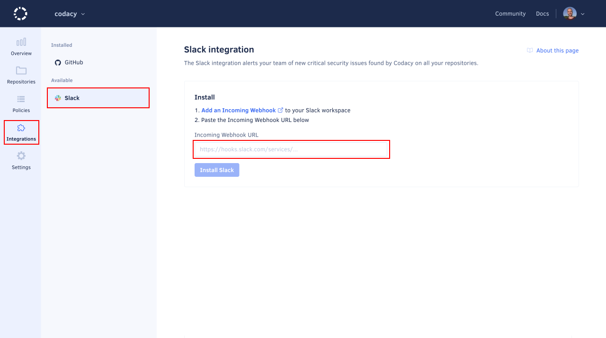
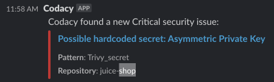

# Organization Slack integration for Security issues

The organization Slack integration for Security issues sends notifications to a Slack channel of your choice whenever Codacy detects new critical Security issues in the default branch of any repository in your organization.

## Installing the Slack integration

To install the Slack integration:

1.  **On Slack**:
    1.  [Create the Codacy app](https://api.slack.com/apps?new_app=1&manifest_json=%7B%22display_information%22%3A%7B%22name%22%3A%22Codacy%22%2C%22description%22%3A%22Posts%20the%20new%20critical%20security%20issues%20Codacy%20finds%20in%20your%20repositories.%22%2C%22background_color%22%3A%22%231a2336%22%7D%2C%22features%22%3A%7B%22bot_user%22%3A%7B%22display_name%22%3A%22Codacy%22%2C%22always_online%22%3Afalse%7D%7D%2C%22oauth_config%22%3A%7B%22scopes%22%3A%7B%22bot%22%3A%5B%22incoming-webhook%22%5D%7D%7D%2C%22settings%22%3A%7B%22org_deploy_enabled%22%3Afalse%2C%22socket_mode_enabled%22%3Afalse%2C%22token_rotation_enabled%22%3Afalse%7D%7D) in Slack. Slack opens **Create from a manifest** with the app settings filled in, and notes that the manifest was created by a third party.

    1.  Select your workspace, click **Next**, then click **Create and Install**.

    1.  Select the channel where you want to receive notifications and click **Allow**.

    1.  Click **Go to App Settings**. Optionally, add the [Codacy logo](images/codacy-slack-app-icon.png) under **App icon & Preview**.

    1.  Open **Incoming Webhooks** and copy the webhook URL (it starts with `https://hooks.slack.com/services/`).

1.  **On Codacy**:

    1.  Open your organization **Integrations**, page **Slack**.

    1.  Paste the webhook URL in the field and click **Install Slack**.

    

Once the Slack integration is installed, Codacy sends a confirmation message to the Slack channel you selected when creating the app. From there on, Codacy notifies you on the same channel whenever a new critical Security issue is detected in the default branch of any repository in your organization.

## Uninstalling the Slack integration

To uninstall the Slack integration, open your organization **Integrations**, page **Slack**, then click **Uninstall Slack** and confirm.
