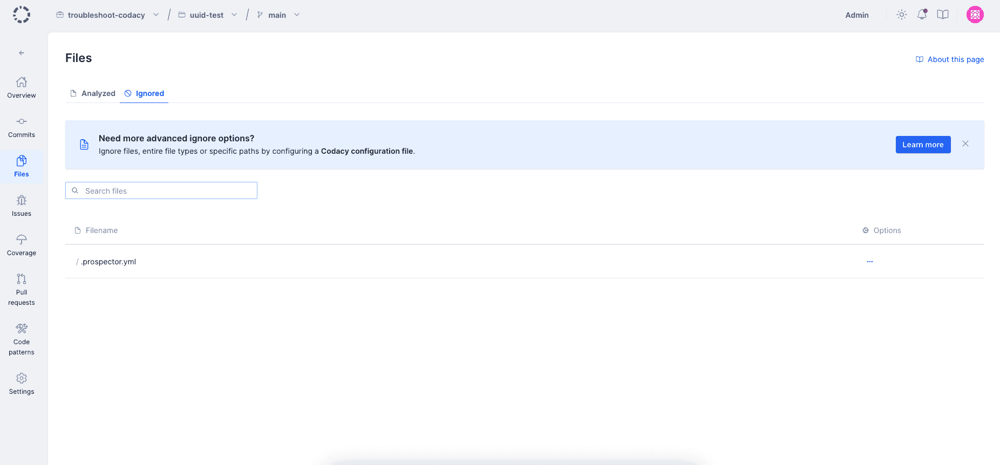
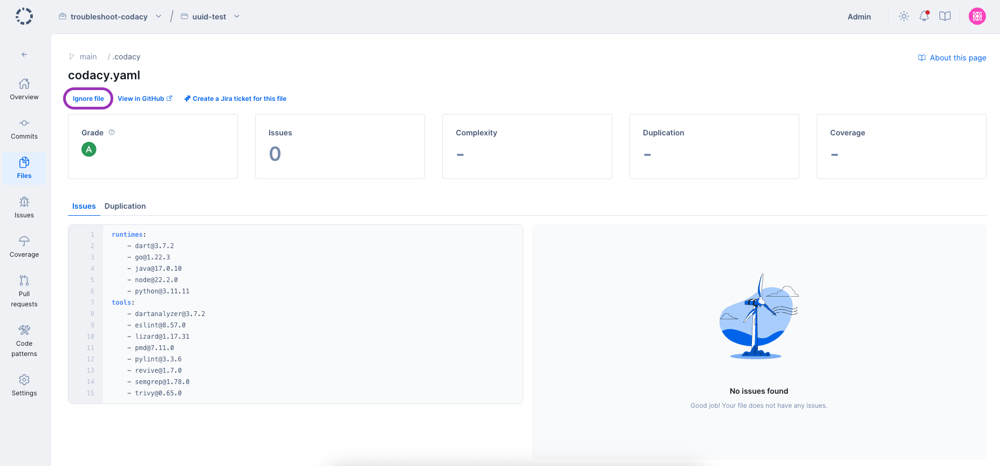
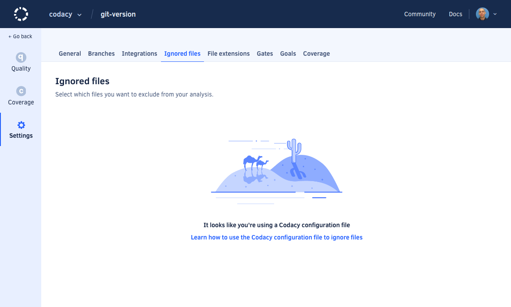

# Ignoring files



Ignore generated code, third-party libraries, and other files that aren't relevant to your project, so that Codacy reports issues only on the code your team maintains. To ignore files, add **ignore rules** to your repository: each rule is a file, a folder, or a pattern that Codacy skips during analysis.

Ignore rules apply to every branch of the repository, starting from the next analysis. Issues and security findings in the ignored files close as fixed.

## Adding ignore rules

To add ignore rules to a repository:

1.  Open your repository **Files** page and select the **Ignore rules** tab.

1.  Click **Add ignore rule**.

1.  Under **Paths**, enter the file, folder, or pattern to ignore. See [how to write a path](#path-syntax).

    To add more than one rule at a time, click **Add another path**. You can add up to 10 paths at a time.

1.  Optionally, expand **Advanced options** to:

    -   **Tools:** Select the tools that skip these paths. By default, a rule applies to **All tools**. See [ignoring files for specific tools](#specific-tools).
    -   **Reason:** Describe why you're ignoring these paths, for example `Generated code`. The reason appears under the path on the list of ignore rules, so your team knows why the rule exists.

1.  Click **Add ignore rule**.

<!-- TODO: retake ignored-files.png from the shipped Ignore rules tab -->


You can also ignore a single file from the **Files** page: select the file and click **Ignore file**.



## Writing a path {: id="path-syntax"}

Paths are relative to the root of your repository and use `/` to separate folders. They use the same glob syntax as [`exclude_paths` in a Codacy configuration file](codacy-configuration-file.md#syntax-for-ignoring-files):

| Path            | Ignored files                                             |
| --------------- | --------------------------------------------------------- |
| `docs/**`       | The folder `docs` and everything in it, including nested folders |
| `docs/*`        | Only the files directly in the folder `docs`              |
| `*.min.js`      | All files ending in `.min.js`, in any folder              |
| `docs/index.md` | The file `docs/index.md`                                  |

To ignore a folder, end the path with `/**`, not with `/`. Codacy doesn't accept:

-   Paths that start with `!`. Add rules only for the paths that you want to ignore. To analyze files that a Codacy default ignores, see [default ignored files](#default-ignored-files).
-   Paths that use `\` to separate folders.
-   Paths that match every file in the repository, such as `**`.

## Ignoring files for specific tools {: id="specific-tools"}

By default, an ignore rule applies to all tools. To ignore a path only for some tools, select those tools under **Advanced options** › **Tools** when you add or edit the rule. The tools that you don't select still analyze the files.

For example, ignore `tests/**` only for the tools that report issues you don't fix in test code, and keep analyzing your tests for security issues with the other tools.

The **Tools** column on the list of ignore rules shows which tools each rule applies to.

## Reviewing your ignore rules

The **Ignore rules** tab lists every rule that applies to the repository:

-   **Path:** The file, folder, or pattern, with the reason under it.
-   **Tools:** **All tools**, or the tools that the rule applies to.
-   **Matching files:** How many files the rule ignores, counted on the last analysis of the default branch. A new rule shows **Not analyzed yet** until the next analysis. When you select a branch other than the default branch, this column is hidden.
-   **Source:** Who added the rule:
    -   **User:** A member of your organization, with the date and the author's name under it.
    -   **Auto-configuration:** [Auto-configure](configuring-code-patterns.md#auto-configuring-your-repository), when it configured the repository.
    -   **Codacy default:** One of the paths that [Codacy ignores by default](#default-ignored-files). The list shows only the defaults that match files in your repository.

Use **Search paths** and the **Source**, **Type**, and **Tools** filters to find a rule.

A rule with 0 matching files ignores nothing in the current code. Check the path for a typo, or delete the rule if the files no longer exist.

## Editing and deleting ignore rules

To edit an ignore rule, click the **⋯** menu on the rule's row and select **Edit**. You can change the path, the tools, and the reason, and then click **Save changes**. If you change the path, Codacy replaces the rule with a new one, with you as the author and today's date.

To delete an ignore rule, click the **⋯** menu on the rule's row, select **Delete**, and confirm with **Delete rule**. From the next analysis, Codacy analyzes the files again and reports their issues.

You can't edit or delete Codacy defaults. To analyze files that a Codacy default ignores, see [default ignored files](#default-ignored-files).

## Choosing between ignore rules and a Codacy configuration file {: id="ignore-rules-or-configuration-file"}

You can also ignore files with `exclude_paths` in a [Codacy configuration file](codacy-configuration-file.md#ignore-files). Use one or the other: **if your repository has a Codacy configuration file, Codacy ignores the files that the configuration file defines, and the ignore rules on the Codacy UI don't apply.**

| | Ignore rules | Codacy configuration file |
|---|---|---|
| Where you manage them | On the Codacy UI, with no commit | In a `.codacy.yml` or `.codacy.yaml` file in your repository |
| Branches | Apply to every branch | Codacy uses the file on the default branch |
| Change history | Each rule shows its author and date | Versioned and reviewed with your code |
| Analyze files that a Codacy default ignores | No | Yes, with [`include_paths`](codacy-configuration-file.md#include-files) |
| Other settings | Ignore rules only | Also configures tools, languages, and duplication and complexity exclusions |

Use ignore rules if you want to ignore files without changing your repository, or if the people who manage Codacy don't commit to the repository.

Use a Codacy configuration file if you want your exclusions reviewed in pull requests alongside the code, if you need to analyze files that a Codacy default ignores, or if you already use the file for other settings.

When a repository has a Codacy configuration file, the **Ignore rules** tab shows the banner **Ignores are managed by your configuration file** and the list is read-only. To change what Codacy ignores, edit the configuration file on your default branch. To move to ignore rules, delete the configuration file from your default branch and then add its `exclude_paths` as ignore rules.

<!-- TODO: retake ignored-files-configuration-file.png from the shipped Ignore rules tab with a configuration file -->


!!! note
    -   You can also ignore files using your own [tool configuration files](configuring-code-patterns.md#using-your-own-tool-configuration-files), although this depends on the option being supported by each tool.

    -   

    -   When excluding files from **Duplication** analysis, you must state the **entire path** to the files. Unlike quality analysis, wildcards will not work, resulting in files not being excluded.

## Limits

Each repository can have up to:

-   **5,000 file and folder rules.**
-   **A limited number of patterns.** Plain folders, such as `docs/**`, and lists of file extensions, such as `**/*.{ts,tsx}`, don't count toward this limit. A pattern with several alternatives can count more than once.

When a repository reaches a limit, Codacy doesn't add the new rule and shows a message that names the limit. To add more rules, delete the rules that you no longer need, starting with the ones with 0 matching files, or replace several rules with one folder rule. For example, one rule `src/generated/**` replaces a rule for each file in that folder.

## Default ignored files

By default, Codacy ignores all the files that match the regular expressions below. If you need to analyze files that match these regular expressions, use a Codacy configuration file to [define a custom list of file paths to include](./codacy-configuration-file.md#include-files).

```text
.*[\.-]min\.css
.*[\.-]min\.js
.*node_modules/.*
.*bower_components/.*
.*vendor/.*
.*third[_-]?[Pp]arty/.*
.*samples?/.*
.*releases?/.*
.*builds?/.*
.*dist/.*
.*external/.*
.*libs/.*
.*d3\.js
.*angular(-resource|)?\.js
.*select2(-resource|)?\.js
.*-ace\.js
.*typeahead\.js
.*jquery-ui\.js
.*reveal\.js
.*three\.js
.*chart\.js
.*jquery\.js
.*underscore\.js
.*lodash\.js
.*bootstrap\.js
.*bootstrap\.css
.*font-awesome\.css
.*\.[Dd]esigner\.cs
```
