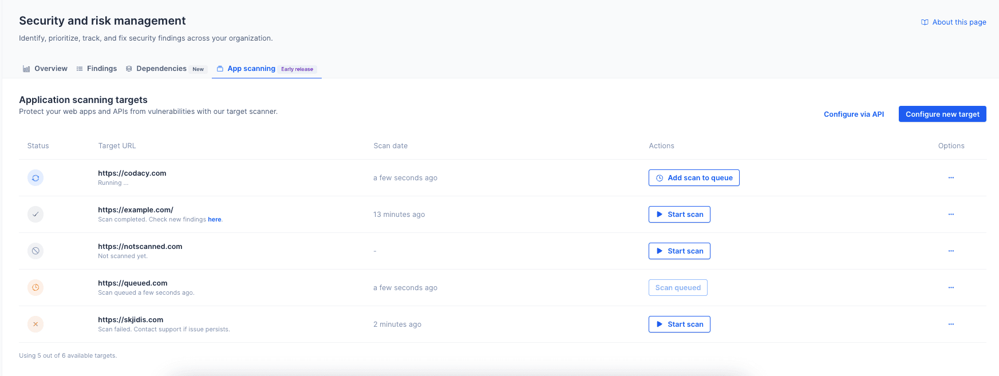
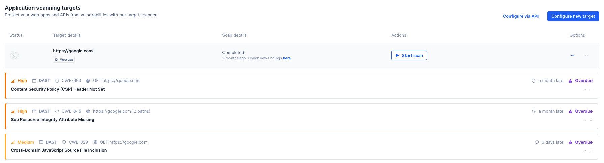

# App scanning

!!! important
    App scanning is a business-tier feature. If you are a Codacy Pro customer interested in upgrading to gain access to this feature, [talk to us](https://start-chat.com/slack/codacy/rmbTzb).

The **Security and risk management > App scanning** page allows organizations to scan Web Applications and APIs for security vulnerabilities. This feature is part of Codacy's Dynamic Application Security Testing (DAST) capabilities, powered by ZAP.

To access the App scanning page, go to the [Overview page](index.md#dashboard) and click the **App scanning** tab.



App scanning analyzes applications in production or production-like environments to help identify vulnerabilities such as misconfigurations, insecure authentication, or other security issues that occur in real-world usage. Because it doesn't rely on access to source code, it’s language-agnostic and useful for validating security across your entire stack. 

Codacy supports two types of scanning:

- **Web application scans** perform baseline, non-intrusive analysis. Unauthenticated web application scans are safe for production environments, but [scans that sign in](#scanning-a-web-app-behind-a-login) belong in a test or staging environment. Web application scans detect surface-level issues such as:
    - Missing security headers
    - Insecure cookie configurations
    - Information disclosure through HTTP response headers
    - Exposure of sensitive or misconfigured files

- **API scans** simulate real-world attacks against your API endpoints. These are more aggressive and best suited for **non-production environments**, such as staging or development. API scans provide deeper insights into runtime behavior and potential vulnerabilities, such as:
    - Broken authentication or authorization controls
    - Injection vulnerabilities (SQL or command injection)
    - Exposure of sensitive data in API responses
    - Insecure CORS or HTTP method configurations

!!! note
    Already using ZAP? [Upload your results via the API.](../codacy-api/examples/uploading-dast-results.md)

## Creating an App Scanning target

!!! important
    **Do not run API scans on production enviroments as our API scanners may cause potential downtime.**

    Our DAST API scanner performs active security testing by sending a large number of requests to your application. When using authenticated API scanning, this activity can be even more intensive, as ZAP explores and probes more of your API surface.

    Depending on how your target environment is configured, this may:

    - Trigger rate limiting or throttling
    - Appear as a high volume of traffic, similar to a load test
    - Lead to incomplete scan results if key endpoints are blocked or limited

    We recommend running scans in a **test or staging environment**, or coordinating with your infrastructure team to ensure that your environment can safely handle the load.

When creating a scan target, you'll be able to choose between a Web App or an API. Configuring a Web App requires a target URL, while APIs will have other requirements:

- **REST APIs**, which require a publicly accessible OpenAPI specification URL.
- **GraphQL APIs**, where the schema is inferred from the default path `{targetUrl}/graphql`.

Web app targets optionally support [**form-based authentication**](#scanning-a-web-app-behind-a-login), and API targets optionally support **header-based authentication**. Any target can also be [linked to a repository](#linking-a-target-to-a-repository). As you create a target, keep in mind you may not be able to view or change certain fields later (to change your configurations you may need to delete and create a new target).

!!! note
    If exposing your API specification isn't feasible for your team, let us know via support or your account representative.

### Linking a target to a repository

Link a target to the repository that holds the application's code so that its findings show up when you filter findings by that repository. The link is optional and works for web app and API targets.

To link a target, select the repository in the **Repository** field. For web apps it sits below the target URL, and for APIs below the API definition URL. The target then shows the repository name as a label on the **App scanning** page. If the repository is later removed from Codacy, the label disappears.

## Scanning a web app behind a login

By default, a web app scan only reaches the pages anyone can open without signing in. With form-based authentication, Codacy signs in through your app's login form before the scan, so the scan also covers the pages behind it.

!!! important
    **Run authenticated scans against a test or staging environment, never production.** While signed in, the scan follows links and submits forms as the user, which can change that user's data.

### Configuring form-based authentication

1.  On the **App scanning** page, click **Configure new target**.
1.  Select **Web app** and click **Next**.
1.  Enter the **Target URL**, optionally select a **Repository**, and click **Next**.
1.  Select **Form-based session** and click **Next**.
1.  Fill in the login details:

    -   **Login page URL:** the page that shows the login form. Leave it empty when the target URL shows the login form. See [when to set the login page URL](#when-to-set-the-login-page-url).
    -   **Username** and **Password:** the credentials of a dedicated test account. See [choosing the account](#choosing-the-account-to-scan-with).

1.  Click **Save target**.

Codacy encrypts the password and never shows it again. To change the credentials, delete the target and create it again.

To create the same target with the Codacy API, see [Trigger DAST scans](../codacy-api/examples/triggering-dast-scans.md#creating-targets).

### Choosing the account to scan with

Create a dedicated test account for scanning instead of using a real user's account:

-   **Turn off multi-factor authentication and CAPTCHAs** for the account. The scan signs in with a username and password only.
-   **Turn off account lockout** for the account. A scan can sign in several times, and a locked account fails every later scan.
-   **Give the account the access you want tested.** The scan only reaches the pages this account can open.
-   **Use an account whose data you can lose.** The scan acts as this user while it crawls.

### When to set the login page URL

The scan looks for the login form on the login page URL, or on the target URL when you leave the login page URL empty. Set the login page URL when the target URL doesn't show the login form, for example:

-   The target URL is a public landing page and the login form is on another page, such as `https://staging.example.com/login`.
-   The login form is on another host, such as `https://auth.example.com/login`.

When the target URL is the login page itself, the scan can confirm that the login succeeded but not that the session holds afterward, because many login pages keep showing the form to signed-in users. For the most reliable results, use a target URL that only signed-in users can see, and set the login page URL.

### Login types that aren't supported

Form-based authentication only supports login forms in the HTML that the server returns. These aren't supported yet:

-   Login forms built by JavaScript, including single-page applications.
-   Logins that ask for the username and the password on separate pages, such as a username step followed by a password step. The username and password inputs must be in the same form.
-   Single sign-on (SSO), such as SAML or OAuth logins.
-   Logins that require multi-factor authentication or a CAPTCHA.

### What the scan does while signed in

Before crawling, the scan signs in and checks that the target URL no longer shows the login form. During the scan, it signs in again whenever it gets one of these responses, since they mean the session ended:

-   A page that shows the login form.
-   An HTTP 401 response.
-   A redirect to the login page.

An HTTP 403 response doesn't count, since a signed-in user can still be forbidden from a page.

To keep the scan from signing itself out or deleting data, an authenticated scan:

-   Skips any URL whose path contains `logout`, `log-out`, `signout`, `sign-out`, `delete`, `remove`, or `destroy`.
-   Doesn't submit forms that use `method="post"`, apart from the login form.

## Why did authentication fail?

When a scan can't sign in, or loses the session and can't sign in again, the scan fails and the target shows an **Auth failed** label next to its status. A failed authenticated scan:

-   Doesn't add new findings or close existing ones, because its results miss the pages behind the login.
-   Isn't retried automatically, since the same credentials would fail again.

The label reflects the target's last finished scan, so it goes away once a later scan finishes without an authentication failure. The Codacy UI only shows the label. To see the exact reason, list the target with the Codacy API and read `lastAuthenticationFailureReason`, as shown in [Trigger DAST scans](../codacy-api/examples/triggering-dast-scans.md#checking-the-last-authentication-result).

### Web app targets with form-based authentication

The reason starts with one of these messages:

-   **No login form found:** check that the login page URL shows the login form, that the username and password inputs are in that same form, and that the form follows [the markup the scan looks for](#how-the-scan-identifies-the-login-fields). The reason includes the URL the scan checked.
-   **Login was rejected:** sign in manually with the same username and password, and check that the account isn't locked or asking for MFA or a CAPTCHA. If the credentials work, check that the scan [picked the right fields](#how-the-scan-identifies-the-login-fields).
-   **The session did not hold:** the target URL still showed the login form after signing in. Check that signed-in pages don't contain the login form, or use a target URL that only signed-in users can see.
-   **Logging in again during the scan failed:** the session ended mid-scan and the new login was rejected. Check for account lockout, and for pages that end the session but aren't [skipped by the scan](#what-the-scan-does-while-signed-in).

Apart from **No login form found**, the reason also names the form and the username field the scan used, so you can check that it picked the right ones.

### API targets with header-based authentication

**Auth failed** means that 90% or more of the responses from the target were HTTP 401 or 403, so the headers were most likely rejected. Check the header name and value. A successful result only means that the API didn't reject the headers, not that every endpoint was reachable.

### How the scan identifies the login fields

You don't map any fields. The scan opens the login page and picks the login form from its HTML:

1.  **The form:** the first form that uses `method="post"` and has exactly one password input with a `name`. Sign-up and change-password forms on the same page usually have two password inputs, so they're skipped.
1.  **The username input:** the first match, in this order:
    1.  An input with `autocomplete="username"`.
    1.  Before the password input, an input with `type="email"`.
    1.  Before the password input, the text input nearest to it.
    1.  Before the password input, an input with `type="tel"`.
    1.  The first text input after the password input.
1.  **The other fields:** hidden fields, such as CSRF tokens, are sent with their values from the page.

If the scan finds no form or picks the wrong field, adjust the login page markup:

-   Render the login form in the server's HTML response, with `method="post"`.
-   Use exactly one password input in the login form, and give each input a `name`.
-   Add `autocomplete="username"` to the username input.
-   Don't show the login form, or another input with the same name as the password input, on pages that signed-in users see. The scan would read those pages as signed out.

For example, the scan finds this form without any guessing:

```html
<form method="post" action="/login">
  <input type="hidden" name="csrf_token" value="...">
  <input type="email" name="email" autocomplete="username">
  <input type="password" name="password" autocomplete="current-password">
  <button type="submit">Sign in</button>
</form>
```

### Failures that aren't authentication failures

These failures don't show the **Auth failed** label, and the scan is retried:

-   **The login page couldn't be reached:** check that the login page URL is correct and that [Codacy's IP addresses](../codacy-api/examples/triggering-dast-scans.md#adding-codacy-to-your-allowlist-for-dast-scans) can reach it.
-   **The scan timed out:** an authenticated web app scan stops after about an hour. If your scans keep timing out, let us know via support or your account representative.

## How to scan a target

You can initiate scans in two ways:
- From the **App scanning** tab in the Security and risk management dashboard
- By automating scans using [Codacy's API](../codacy-api/examples/triggering-dast-scans.md)

!!! important
    Only [admins and organization managers](../organizations/roles-and-permissions-for-organizations.md) can create targets and start scans, both in-app and via the API.

<div>
  <iframe width="100%" height="472" src="https://www.youtube.com/embed/qPwHlIGJYXs?autoplay=1&mute=1&showinfo=0&loop=1" title="DAST targets" frameborder="0"
allowfullscreen>
  </iframe>
</div>

Each organization can have up to **6 active scan targets** by default. If you need more targets, click **Talk to us** on the **App scanning** tab or contact your customer success representative. The tab shows your usage as "Using X out of Y available targets."

Scans are triggered manually through the UI and are queued before execution. You can queue one single scan per target—it will run sequentially. There is no limit to the number of scans you can run on a target, in order to support your deployment needs.

Once a scan completes, results will be available under the **Findings** tab. Use the **Scan types > DAST/App scanning** filter to view relevant findings.

!!! important
    Depending on the complexity of the target, DAST scans can take a significant amount of time to complete. Codacy may enforce timeouts to ensure platform stability and fair resource distribution.

!!! important
    Failed scans are retried based on the failure reason. Retries are added back to the queue automatically and processed when capacity allows.

!!! note
    Currently, DAST findings are only visible to admin and organization admin roles.

## Findings results for your DAST scans

As previously mentioned, once a scan completes, results will be available under the **Findings** tab. Use the **Scan types > DAST/App scanning** filter to view relevant findings.
Additionally, you can click on a configured target to expand all that target's results.



Follow our [roadmap](https://roadmap.codacy.com) for updates on this feature.

