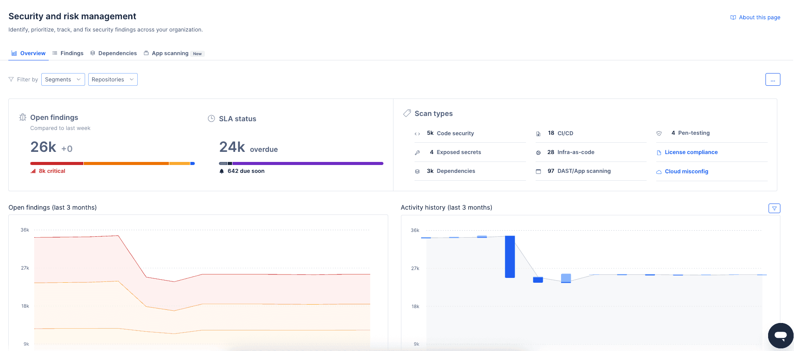
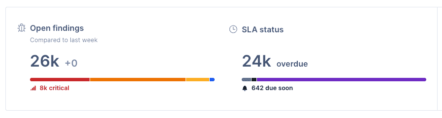
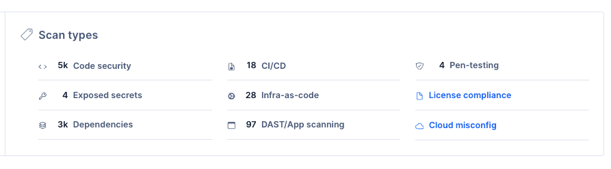
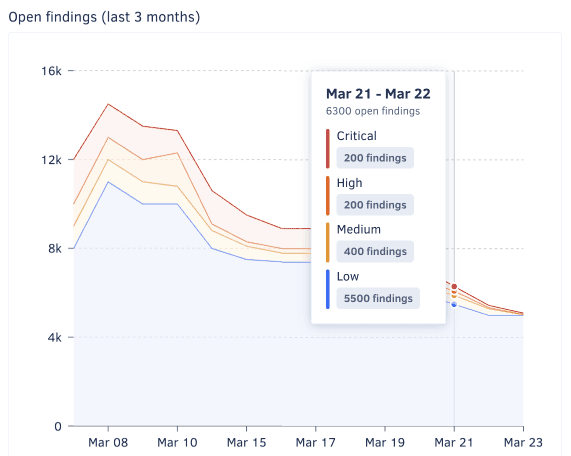
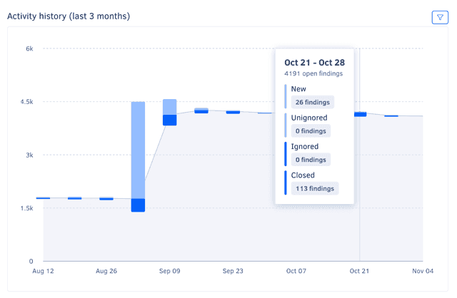
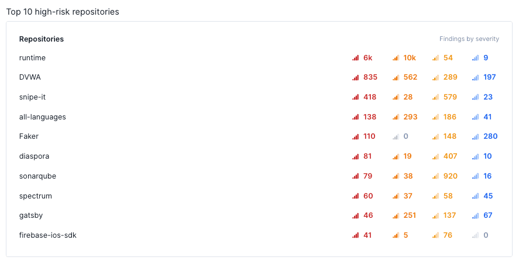
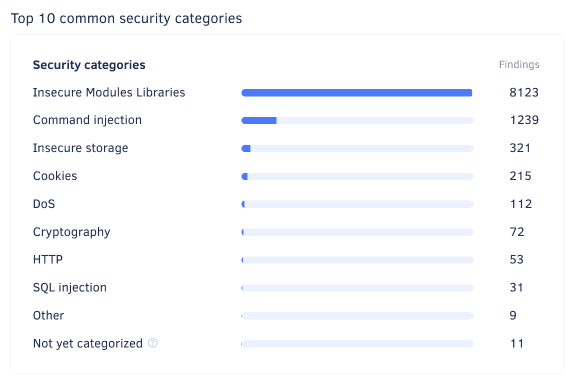

# Reports

The **Reports** tab of Security and risk management has two reports:

-   [Overview](#overview): the security posture of your organization, with open findings by severity, scan type distribution, resolution history, and your highest-risk repositories.
-   [Remediation](#remediation-report): how fast your organization fixes findings of each severity against your SLAs, and how many are overdue right now.

To open the Reports tab, select an organization from the top navigation bar and select **Security and risk** on the left navigation sidebar. The **Overview** report opens by default. To switch reports, select **Overview** or **Remediation** at the top of the tab.

## Overview {: id="overview"}

The **Overview** report provides a high-level view of the security posture of your organization, including the number of open findings, the distribution of open findings by severity, the history of finding resolution, and a breakdown of the most high-risk repositories and most detected security categories.

Use this report to assess your organization's security posture and its progress over time, identify areas for improvement, and share findings with stakeholders.

The Overview report includes six panels:

-   [Open findings overview](#open-findings-overview)
-   [Scan types distribution](#scan-types-distribution)
-   [Open findings history](#open-findings-history)
-   [Activity history](#activity-history)
-   [Top 10 high-risk repositories](#top-10-high-risk-repositories)
-   [Top 10 common security categories](#top-10-common-security-categories)

To limit the information displayed in each panel, use the filter drop-down above the main area, and choose the relevant repositories, or utilise [**Segments**](../organizations/segments.md).
!!! info "Check out how to [enable and configure **Segments**](../organizations/segments.md#enabling-segments)"

### Open findings overview

The **Open findings overview** panel displays the total number of open security findings and the number of findings of each severity, helping you quickly assess the overall security posture of your organization and quickly review findings that are critical or overdue.

Within this same panel, an additional visualization shows the relative distribution of open findings by status, helping you evaluate the distribution of risk across different criteria and identify areas that may need immediate attention.

To access the findings page with the corresponding filter applied, click on a number or bar area.

### Scan types distribution

The **Scan types** panel shows the relative distribution of open findings by scan type. To access the findings page with the corresponding filter applied, click on a number from the panel.

### Open findings history

The **Open findings history** graph shows the open findings trends over the past three months, grouped by week and severity. It details the progression of your organization's risk and security posture over time and can, for example, help you understand if the right issues are being addressed.

For a detailed view of the distribution on a specific week, hover over the graph.

### Activity history

The **Activity history** graph shows weekly counts of open, closed, ignored and unignored findings over the past three months, overlaid on the overall open findings trend. It complements the **Open findings history** graph with more information, such as the volume of findings addressed each week and a visual representation of the new/closed ratio.

To filter the graph by finding severity, use the drop-down in the top right-hand corner of the panel.

For a detailed view of the counts on a specific week, hover over the graph.

### Top 10 high-risk repositories

The **Top 10 high-risk repositories** list shows the repositories with the highest number of open findings, ordered by severity.

!!! note
    This panel may list fewer than ten repositories if there are fewer than ten repositories with open findings in the organization or if fewer than ten repositories are selected in the dropdown **Repository** filter.

### Top 10 common security categories

The **Top 10 common security categories** list shows the most common security categories of open findings, ordered by count.

To access the findings page with the corresponding filter applied, click on a category.

## Remediation report {: id="remediation-report"}

The **Remediation report** shows, for each finding severity, how fast your organization closes findings compared with your [SLAs](findings.md#item-configurable-deadlines), what share of them closed on time, and how many are overdue right now. Use it to show auditors and stakeholders that your team fixes security findings within the deadlines it agreed to.

To open the report, select an organization from the top navigation bar, select **Security and risk** on the left navigation sidebar, open the **Reports** tab, and select **Remediation**.

<!-- TODO: verify — add a screenshot of the Remediation report (images/security-risk-management-remediation-report.png) once OD-958 ships the final layout -->

The report has one panel per severity: Critical, High, Medium, and Low. There's no combined figure for all severities, because each severity has its own SLA to compare against.

To configure the SLAs the report uses, click **Configure SLAs** in the top right-hand corner of the report. This opens the same settings as [customizing deadlines](findings.md#item-configurable-deadlines) on the Findings page.

### What the report counts {: id="remediation-report-rules"}

Every figure in the report follows these rules:

-   **Last 90 days:** The mean time to remediate, the on-time share, and the trend use findings closed in the last 90 days. The **Open backlog today** section uses findings that are open now, whenever they were created.
-   **Today's SLAs:** Codacy compares every finding against the SLA set for its severity today, not the SLA in force when the finding closed. If your organization never saved its own SLAs, the report uses the [Codacy default deadlines](findings.md#item-severities-and-deadlines).
-   **Ignored findings aren't counted:** A finding that's ignored when you open the report counts neither as closed nor as open, whatever the reason it was ignored. This applies even if the finding closed before it was ignored.
-   **The clock starts when Codacy creates the finding:** Codacy measures time from the moment it opened the finding, not from a date in the source, such as the creation date of a Jira issue. This is the same rule that sets each finding's deadline.
-   **Every source counts:** Findings from Codacy analysis, Jira, penetration testing, app scanning, and container scanning all count, as on the [Overview](#overview).
-   **No minimum time:** Findings closed less than a day after Codacy opened them count like any other.

!!! important
    Changing an SLA changes past results. Because the report compares every closed finding against today's SLAs, editing an SLA recalculates the on-time share and the **Within SLA** or **Over SLA** status for the whole 90 days.

### Closed in the last 90 days {: id="remediation-report-closed"}

The top of each panel describes the findings of that severity that closed in the last 90 days:

-   **Within SLA or Over SLA:** **Within SLA** when the mean time to remediate is at or under the severity's SLA, **Over SLA** when it's above.
-   **Mean time to remediate:** The average number of days between the moment Codacy opened a finding and the moment it closed. The bar shows the mean against a marker for the SLA, blue at or under the SLA and red above it.
-   **Trend icon:** Whether findings of this severity are getting slower or faster to close over the 90 days. See [how the trend is calculated](#remediation-report-trend).
-   **On time:** The share of closed findings that closed no later than their deadline, followed by the counts it's based on, for example **2,404 of 3,343 closed**.

If no findings of a severity closed in the last 90 days, its panel says so and still shows the SLA and the open backlog.

### Mean by week {: id="remediation-report-weekly"}

The chart in each panel shows the mean time to remediate for each week of the last 90 days as a line, against a dashed line for the SLA. Behind the line, bars show how many findings closed that week, split into closed on time and closed late. A week where your team closes many old findings then reads as a spike in closes, not as a sudden slowdown.

To see a week's mean, SLA, closes on time and late, and share on time, hover over the chart.

Weeks start on Monday. The first and last weeks of the 90 days are partial and labeled with their dates.

The four charts share one axis, so the SLA lines sit at their true heights and you can compare severities directly. When one severity is much slower than the others, the axis switches to a square root scale so the other charts stay readable. Hover over a week to see the exact number of days.

### How the 90-day trend is calculated {: id="remediation-report-trend"}

The trend icon next to the mean time to remediate compares the start and the end of the 90 days, without letting a single week set the direction:

1.  Codacy takes the mean time to remediate of each complete week in the 90 days. The current week is left out because it isn't over yet, and weeks with no closed findings are skipped.
1.  It fits a straight line through the weekly means, weighting each week by how many findings closed in it. A week with 200 closes counts more than a week with 2.
1.  It compares the line's value at the first complete week with its value at the last one.

The icon then shows one of three directions:

| Icon | Trend | When |
|------|-------|------|
| Red arrow up | Slower | The end of the line is higher than the start |
| Green arrow down | Faster | The end of the line is lower than the start |
| Grey arrow right | Steady | Start and end differ by less than 10% of the SLA or less than 1 day, whichever is larger |

To see the trend and both ends of the line in days, for example **From 8 → 56 days**, hover over the icon.

The icon doesn't show when:

-   Fewer than 5 findings of that severity closed in the last 90 days.
-   Fewer than 3 findings closed in either the older or the newer half of the 90 days. With so few closes at one end, a single finding would set the direction.
-   The weekly history is still loading or failed to load.

### Open backlog today {: id="remediation-report-backlog"}

The bottom of each panel describes the findings of that severity that are open now, so a good closing record can't hide findings nobody is working on:

-   **Overdue:** Open findings past their deadline. This is the same rule as the **Overdue** [finding status](findings.md#item-statuses).
-   **90+ days late, 30-90 days late, 1-30 days late:** The overdue findings, split by how many days each one is past its deadline. Days late count from the deadline, not from when Codacy opened the finding: a High finding opened 161 days ago with a 20-day SLA is 141 days late. A finding exactly 30 days late counts under **1-30 days late**, and one exactly 90 days late under **30-90 days late**.
-   **Due soon and On track:** Open findings that aren't overdue yet, using the same [finding statuses](findings.md#item-statuses) as the rest of Security and risk management.

To see the overdue findings of a severity, click **Open in Findings**. The Findings page opens filtered by that severity, the **Overdue** status, and the report's filters.

### Filter the report {: id="remediation-report-filters"}

To narrow the report, use the **Segments**, **Repositories**, and **Scan types** filters above the report. The filters apply to every figure, the trend included, and carry over to **Open in Findings**.

The filters are kept in the page URL, so you can share a filtered report by copying the link.
